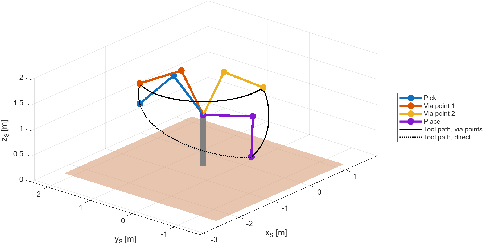
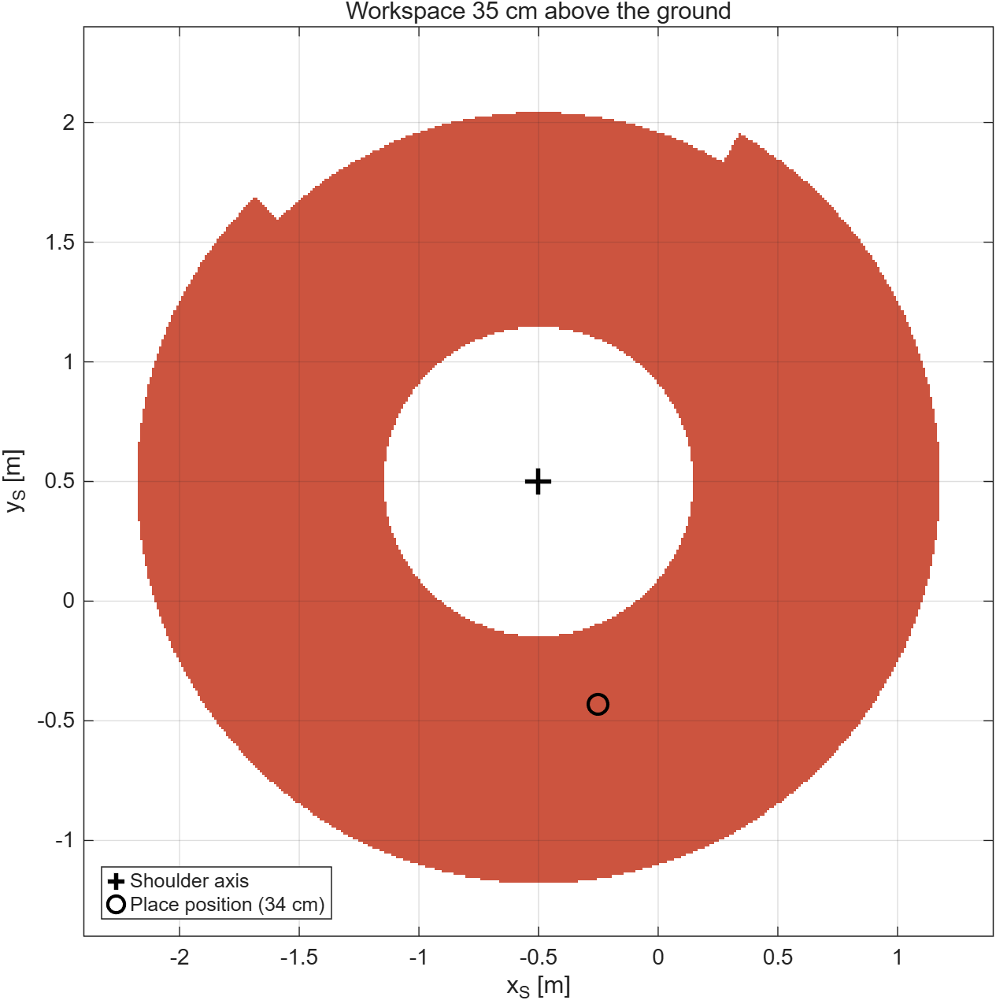
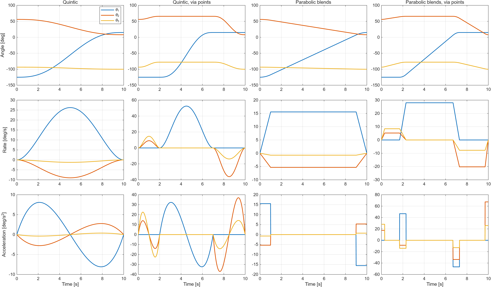
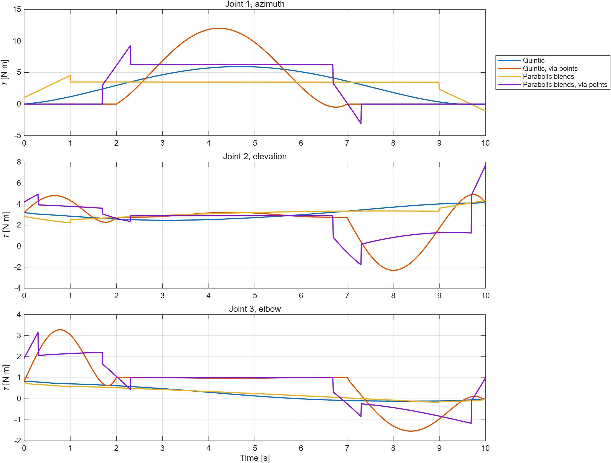
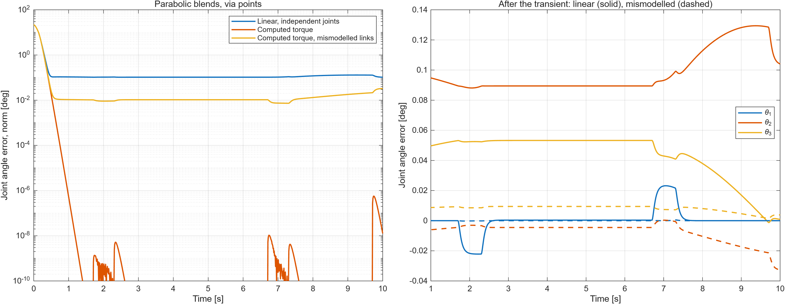
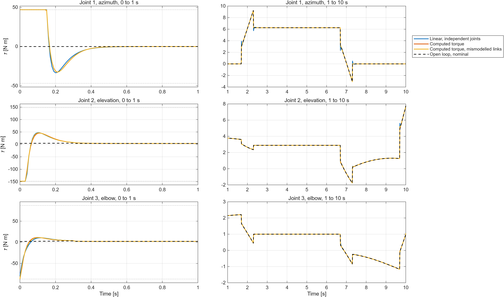

# Mars manipulator control

Kinematics, trajectory generation, dynamics and control of a three-joint arm on Mars, in MATLAB.
The arm is a simplified model of the Instrument Deployment Arm of NASA's InSight lander: it picks an instrument from the lander deck and places it on the ground in 10 s.

<p align="center">
  
</p>

## The problem

The arm has a shoulder azimuth, a shoulder elevation and an elbow joint, and two links of 1 m and 0.8 m modelled as hollow carbon fibre and titanium cylinders (0.87 kg and 0.70 kg).
Each joint is driven by a DC motor through a 125:1 or 100:1 gearbox, with viscous and Coulomb friction and torque and angle limits.
The shoulder is 1 m above the ground on the lander deck; Mars gravity is 3.71 m/s².

1. **Kinematics.** Denavit-Hartenberg parameters, base to tool transform, workspace section 35 cm above the ground.
2. **Inverse kinematics and trajectories.** Joint angles at the pick and place positions; joint trajectories in 10 s with a 0.1 s step, with fifth order polynomials and with linear segments and parabolic blends, with and without via points.
3. **Dynamics.** Equations of motion and the torques the motors must deliver.
4. **Control.** A linear and a nonlinear controller, starting from an erroneous initial position, first with a perfect model and then with wrong link lengths (1.15 m and 0.73 m).

## Running it

Requires base MATLAB only (no toolboxes). Tested with R2026a.

```matlab
main          % all tasks: figures in results/figures, numbers in results/summary.txt (about 1.5 min)
check_model   % independent checks of kinematics and dynamics
```

All problem data and design choices are in [`src/arm_parameters.m`](src/arm_parameters.m).

| File | Content |
|---|---|
| `main.m` | Runs all tasks |
| `check_model.m` | Kinematics round trips, dynamics against a Lagrangian model, energy conservation |
| `src/arm_parameters.m`, `src/link_properties.m` | Problem data, link masses and inertias |
| `src/dh_transform.m`, `src/forward_kinematics.m` | Modified DH chain, tool and elbow positions |
| `src/inverse_kinematics.m`, `src/elbow_up_solution.m` | All four closed form solutions, elbow up choice |
| `src/workspace_section.m` | Workspace section at a given height |
| `src/quintic_trajectory.m`, `src/lspb_trajectory.m` | Trajectories through path points, evaluated at any time |
| `src/arm_dynamics.m`, `src/joint_friction.m`, `src/inverse_dynamics.m` | M(q), V(q, q̇), G(q), friction, motor inertias |
| `src/independent_joint_control.m`, `src/computed_torque_control.m` | Linear and nonlinear control laws |
| `src/simulate_control.m` | Closed loop simulation with torque saturation (ode45) |
| `src/plot_results.m` | Figures |

## Kinematics

Modified DH parameters (Craig):

| i | α<sub>i−1</sub> | a<sub>i−1</sub> | d<sub>i</sub> | θ<sub>i</sub> |
|---|---|---|---|---|
| 1 | 0 | 0 | 0 | θ<sub>1</sub> |
| 2 | 90° | 0 | 0 | θ<sub>2</sub> |
| 3 | 0 | L<sub>1</sub> | 0 | θ<sub>3</sub> |
| T | 0 | L<sub>2</sub> | 0 | 0 |

The tool position is (r cos θ<sub>1</sub>, r sin θ<sub>1</sub>, L<sub>1</sub> sin θ<sub>2</sub> + L<sub>2</sub> sin(θ<sub>2</sub>+θ<sub>3</sub>)) with r = L<sub>1</sub> cos θ<sub>2</sub> + L<sub>2</sub> cos(θ<sub>2</sub>+θ<sub>3</sub>).
The inverse kinematics has four closed form solutions; the elbow up one is chosen, with the elbow above the line from shoulder to tool, which keeps the arm clear of the deck.

| | θ<sub>1</sub> | θ<sub>2</sub> | θ<sub>3</sub> |
|---|---:|---:|---:|
| Pick | −125.0° | 56.0° | −93.5° |
| Via point 1, tool lifted 40 cm | −125.0° | 65.7° | −77.9° |
| Via point 2, final azimuth | 15.0° | 65.7° | −77.9° |
| Place | 15.0° | 8.0° | −100.0° |

<p align="center">
  
</p>

The workspace section is a ring around the shoulder axis.
The azimuth joint cannot turn between 150° and −135°, but that 75° wedge is still almost all reachable: the point is below the shoulder, and the arm can reach it backwards, with the azimuth turned by 180° and the elevation below −90°.
Only the two small notches at the edges of the wedge are lost.

## Trajectories and torques



The via points make the manoeuvre safe: the tool is first lifted 40 cm straight up from the deck, then the arm turns in azimuth with its shape frozen, and only then lowers the tool to the ground.
Fifth order polynomials stop at each via point; parabolic blends do not stop, pass near the via points and have piecewise constant accelerations, hence the steps in the torques.

The equations of motion, τ = M(θ)θ̈ + V(θ, θ̇) + G(θ) + F(θ̇), were derived with the iterative Newton-Euler algorithm.
The vertical plane of the arm is a plane of symmetry, so the azimuth is coupled to the other joints only through velocity terms:

- M<sub>11</sub> = I<sub>t1</sub> cos²θ<sub>2</sub> + I<sub>a1</sub> sin²θ<sub>2</sub> + m<sub>1</sub> r<sub>1</sub>² + I<sub>t2</sub> cos²θ<sub>23</sub> + I<sub>a2</sub> sin²θ<sub>23</sub> + m<sub>2</sub> r<sub>2</sub>², with r<sub>1</sub>, r<sub>2</sub> the horizontal distances of the centres of mass from the azimuth axis
- M<sub>22</sub> = I<sub>t1</sub> + I<sub>t2</sub> + m<sub>1</sub>L<sub>1</sub>²/4 + m<sub>2</sub>(L<sub>1</sub>² + L<sub>2</sub>²/4 + L<sub>1</sub>L<sub>2</sub> cos θ<sub>3</sub>), M<sub>23</sub> = I<sub>t2</sub> + m<sub>2</sub>(L<sub>2</sub>²/4 + L<sub>1</sub>L<sub>2</sub>/2 cos θ<sub>3</sub>), M<sub>33</sub> = I<sub>t2</sub> + m<sub>2</sub>L<sub>2</sub>²/4, M<sub>12</sub> = M<sub>13</sub> = 0
- G = g (0, (m<sub>1</sub>L<sub>1</sub>/2 + m<sub>2</sub>L<sub>1</sub>) cos θ<sub>2</sub> + m<sub>2</sub>L<sub>2</sub>/2 cos θ<sub>23</sub>, m<sub>2</sub>L<sub>2</sub>/2 cos θ<sub>23</sub>)
- V from the Christoffel symbols of M (see [`src/arm_dynamics.m`](src/arm_dynamics.m))
- motors: η²I<sub>m</sub> added to the diagonal of M; friction η²B<sub>m</sub>θ̇ + η τ<sub>c</sub> at each joint

`check_model.m` verifies them against a Lagrangian model built numerically from the DH frames (relative agreement 10⁻⁹ for M and G, 10⁻⁶ for V, limited by finite differences) and checks that the energy of the free arm is conserved to 10⁻¹⁰ over 10 s.



The torques stay far below the motor limits (47, 148 and 87 N m), at most 12 N m on the azimuth.
On the azimuth they are mostly viscous friction: through a 125:1 gearbox, the motor friction becomes 12.8 N m s/rad at the joint.

## Control

Both controllers start from the erroneous initial position of the assignment, 15° away from the trajectory on two joints.
The gains are k<sub>p</sub> = 500 s⁻² and k<sub>d</sub> = 2√k<sub>p</sub>, for critically damped error dynamics with a natural frequency of 22 rad/s.

- **Linear, independent joints.** Each joint is a unit mass after τ = α(θ̈<sub>d</sub> + k<sub>d</sub>ė + k<sub>p</sub>e) + βθ̇, with α the largest effective inertia of the joint (arm stretched out, motor included) and β = η²B<sub>m</sub>.
- **Computed torque.** τ = M(θ)(θ̈<sub>d</sub> + k<sub>d</sub>ė + k<sub>p</sub>e) + V + G + F, which makes the error dynamics linear and decoupled.
- **Computed torque, mismodelled links.** The same law with the model of 1.15 m and 0.73 m links (masses and inertias recomputed), on the real arm.



| Parabolic blends with via points | Error below 1° after | Largest error after 2 s (θ<sub>1</sub>, θ<sub>2</sub>, θ<sub>3</sub>) |
|---|---:|---|
| Linear, independent joints | 0.31 s | 0.023°, 0.129°, 0.053° |
| Computed torque | 0.30 s | below 10⁻⁶° |
| Computed torque, mismodelled links | 0.30 s | 0.0005°, 0.033°, 0.009° |

The motors saturate for the first 0.15 s and all three controllers cancel the initial error in about 0.3 s.
After that, the residual error of the linear controller is gravity: the law does not compensate it, so the elevation joint settles where k<sub>p</sub>αe balances G, at e = G/(αk<sub>p</sub>) = 0.128°, which is exactly the simulated value.
The mismodelled computed torque controller is four times better than the linear one even with links 15% and 9% off, because the bulk of the gravity torque is still compensated.



## References

- J. J. Craig, *Introduction to Robotics: Mechanics and Control*, Pearson (DH convention, Newton-Euler dynamics, trajectories, control).
- B. Siciliano, L. Sciavicco, L. Villani, G. Oriolo, *Robotics: Modelling, Planning and Control*, Springer.
- A. Trebi-Ollennu et al., "InSight Mars lander robotics instrument deployment system", *Space Science Reviews*, 214, 2018.

## Author

Francesco Mazzei · [framazzei3.github.io](https://framazzei3.github.io)
